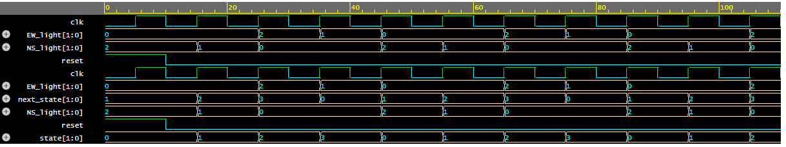

# Traffic Light Controller - Verilog

4-way traffic signal controller using FSM in Verilog.

## How it Works
- NS Green -> NS Yellow -> EW Green -> EW Yellow -> Repeat
- Light Encoding: 00 = Red, 01 = Yellow, 10 = Green

## Files
- traffic_light_controller.v - Main Design
- tb_traffic_controller.v - Testbench

## How to Run
Use EDA Playground or Vivado to simulate with the testbench.
## Output

